<h1 align="center">Hi 👋, I'm Debarati Seal</h1>
<h3 align="center">Full-stack developer and final-year IT undergrad at RCCIIT</h3>

  

 <a href="https://github.com/ryo-ma/github-profile-trophy"><picture><source media="(prefers-color-scheme: dark)" srcset="https://github-profile-trophy.screw-hand.vercel.app/?username=dfordebarati&amp;row=1&amp;column=6&amp;theme=darkhub"></picture></a> 

  

- 💼 Ex intern at **IELTS Proficiency**

- 🎤 Ex Web & Web3 associate at **GDSC RCCIIT**

- 💬 Ask me about **Next.js, TypeScript, Supabase and the MERN stack**

- 🌐 My portfolio: **[debarati.runs-on.dev](https://debarati.runs-on.dev)**

- 📫 How to reach me **dfordebarati@gmail.com**

- ⚡ When I'm not coding, I'm travelling ✈️, playing video games 🎮 or listening to music 🎧

<h3 align="left">Achievements:</h3>

- 🏆 **Top 3 of 790+ projects** at HackHazards 2025, a global hackathon with 2,900+ teams

- 🥇 **1st place** in the Software Development track at Techtrix 2025

- 🏅 **4th place** at AIgnite 2025, East India's largest GenAI hackathon

- 🌟 **Top 50 campus ambassador (#27)** at GirlScript Summer of Code 2024

- 📜 Postman API Fundamentals Student Expert, and **5-star in SQL** on HackerRank

<h3 align="left">Connect with me:</h3>

<h3 align="left">Languages and Tools:</h3>

                  

<picture><source media="(prefers-color-scheme: dark)" srcset="https://raw.githubusercontent.com/dfordebarati/dfordebarati/main/profile/stats-dark.svg"></picture>
<picture><source media="(prefers-color-scheme: dark)" srcset="https://raw.githubusercontent.com/dfordebarati/dfordebarati/main/profile/top-langs-dark.svg"></picture>

<picture><source media="(prefers-color-scheme: dark)" srcset="https://streak-stats.demolab.com/?user=dfordebarati&amp;disable_animations=true&amp;theme=github-dark-blue"></picture>

